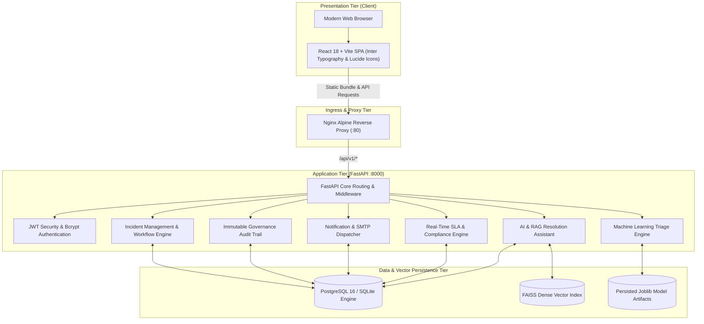
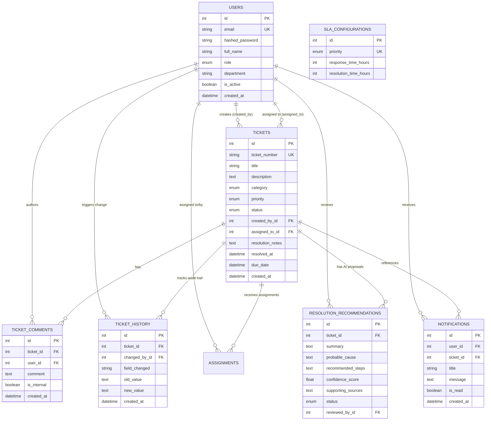

# NEXUS AI — Enterprise AI-Powered IT Service Management & Automated Incident Resolution Platform

[](https://www.python.org/)
[](https://fastapi.tiangolo.com/)
[](https://react.dev/)
[](https://vitejs.dev/)
[](https://www.postgresql.org/)
[](https://www.docker.com/)
[](https://github.com/)
[](LICENSE)

> **NEXUS AI** is an enterprise-grade IT Service Management (ITSM) and automated incident resolution platform. It combines classical machine learning classification, dense vector semantic search (FAISS), Retrieval-Augmented Generation (RAG), and real-time SLA tracking into a unified, human-governed enterprise portal.

---

## Table of Contents

- [1. Problem Statement & Solution](#1-problem-statement--solution)
- [2. System Architecture](#2-system-architecture)
- [3. Key Platform Capabilities](#3-key-platform-capabilities)
- [4. Database Design (Entity-Relationship)](#4-database-design-entity-relationship)
- [5. Machine Learning Pipeline & Real Evaluation Metrics](#5-machine-learning-pipeline--real-evaluation-metrics)
- [6. AI Resolution Assistant & Vector RAG Pipeline](#6-ai-resolution-assistant--vector-rag-pipeline)
- [7. Technology Stack](#7-technology-stack)
- [8. Quickstart Guide (Local Development)](#8-quickstart-guide-local-development)
  - [Option A: Docker Compose (1-Command Launch)](#option-a-docker-compose-1-command-launch)
  - [Option B: Local Setup (Windows PowerShell)](#option-b-local-setup-windows-powershell)
- [9. Public Cloud Deployment Guide (Vercel + Render + PostgreSQL)](#9-public-cloud-deployment-guide-vercel--render--postgresql)
- [10. Seeded Default Accounts](#10-seeded-default-accounts)
- [11. REST API Specification Summary](#11-rest-api-specification-summary)
- [12. Technical Decisions & Trade-Offs](#12-technical-decisions--trade-offs)
- [13. Interview Preparation & Resume Highlights](#13-interview-preparation--resume-highlights)

---

## 1. Problem Statement & Solution

### The Enterprise Challenge
Enterprise IT support organizations handle thousands of incoming tickets each month. Key operational bottlenecks include:
1. **Manual, Error-Prone Triage**: Routing tickets to the wrong team or assigning incorrect priorities causes costly delays.
2. **Repetitive Diagnoses**: Support agents spend hours re-diagnosing issues that have already been documented in standard operating procedures (SOPs) or resolved in historical tickets.
3. **SLA Penalties**: Lack of proactive alerting means high-priority tickets sit unaddressed until contractual breach thresholds are crossed.
4. **The Hallucination Danger in IT**: Directly hooking raw LLMs into production IT systems risks generating hallucinated, destructive commands (e.g., unintended restarts, dropped tables, or dangerous firewall changes).

### The NEXUS AI Solution
NEXUS AI introduces an end-to-end, multi-stage automated workflow:
- **Instant ML Triage**: Predicts incident category and SLA priority in <10ms upon submission.
- **Dense Vector RAG**: Converts incident descriptions into 128-dimensional dense semantic vectors and performs exact cosine similarity search over curated enterprise SOPs using FAISS.
- **Strict Human-in-the-Loop Guardrail**: AI recommendations remain isolated in a `Pending Review` state. IT Support Agents must explicitly **Approve** or **Reject** recommendations before any resolution notes are applied.
- **Live SLA & MTTR Analytics**: Calculates real-time countdown timers, identifies tickets at risk (<2h remaining), tracks Mean Time To Resolution (MTTR), and logs every field modification to an immutable governance audit trail.

---

## 2. System Architecture



---

## 3. Key Platform Capabilities

| Capability | Description |
|---|---|
| **Role-Based Access Control (RBAC)** | Dedicated portal views and authorization boundaries for `Employee`, `IT Support Agent`, and `Administrator`. |
| **Automated ML Classification** | Automatically classifies incident category and predicts SLA priority upon ticket creation. |
| **Similar Incident Detection** | Performs semantic vector similarity matching against historical resolved incidents to suggest proven procedures. |
| **FAISS Vector Search & RAG** | Retrieves the Top-K most relevant Standard Operating Procedures without external network dependencies. |
| **LLM Provider Abstraction** | Pluggable interface supporting Google Gemini API with a zero-cost, offline fallback synthesizer that guarantees grounded citations. |
| **Human-in-the-Loop Review** | Full review interface allowing agents to inspect problem causes, edit remediation steps, and approve/reject AI suggestions. |
| **Real-Time SLA Monitoring** | 3-state SLA tracking (`On Track`, `At Risk`, `Breached`) with active overdue countdowns. |
| **Enterprise Analytics** | Dynamic dashboard showing MTTR, SLA compliance rates, category/priority volumes, and agent workload capacity. |
| **Governance Audit Trail** | Immutable log recording every field-level change (`old_value`, `new_value`, user, timestamp). |
| **Multi-Channel Notifications** | Real-time in-app notification dropdown with unread badge counter, paired with an SMTP email dispatcher. |

---

## 4. Database Design (Entity-Relationship)



---

## 5. Machine Learning Pipeline & Real Evaluation Metrics

NEXUS AI does not rely on synthetic claims or fabricated accuracy figures. The machine learning pipeline was trained and evaluated on an 820-sample enterprise incident dataset (`data/raw/incidents.csv`) split into 80% training and 20% independent testing sets (`test_samples = 164`).

### Pipeline Architecture
- **Text Preprocessing**: Normalized tokenization, lowercasing, technical regex token preservation (preserving IP addresses as `ipaddress`, sanitizing URLs).
- **Feature Extraction**: `TfidfVectorizer(ngram_range=(1,2), sublinear_tf=True, min_df=2)`. Captures critical enterprise bigrams (e.g., "vpn tunnel", "connection pool", "memory leak").
- **Model Classifier**: Multi-class `LogisticRegression(class_weight='balanced', max_iter=1000, random_state=42)`.

### Verified Model Performance Metrics
*(Stored in `data/processed/model_metrics.json`)*

| Model Target | Accuracy | Precision (Weighted) | Recall (Weighted) | F1-Score (Weighted) | Macro F1 | Test Set Size |
|---|---|---|---|---|---|---|
| **Incident Category** | **92.07%** | **92.16%** | **92.07%** | **0.9191** | **0.9084** | 164 tickets |
| **Incident Priority** | **85.98%** | **86.35%** | **85.98%** | **0.8610** | **0.8524** | 164 tickets |

#### Breakdown by Category
- **Hardware**: 100.0% Recall, 0.966 F1
- **Database**: 100.0% Recall, 0.964 F1
- **Network**: 92.3% Recall, 0.923 F1
- **Security**: 92.6% Recall, 0.926 F1
- **Authentication**: 92.0% Recall, 0.902 F1
- **Application**: 76.0% Recall, 0.844 F1
- **Software**: 83.3% Recall, 0.833 F1

---

## 6. AI Resolution Assistant & Vector RAG Pipeline

```
[Incoming Incident Description]
               │
               ▼
   [Text Cleaning & Tokenizer]
               │
               ▼
 [128-d Dense Semantic Projection (L2 Normalized)]
               │
               ▼
 [FAISS IndexFlatIP Cosine Similarity Search]
               │
               ▼
 [Top-K Retrieved SOPs & Knowledge Documents]
               │
               ▼
 [LLM Provider Interface (Gemini API or Offline Fallback)]
               │
               ▼
 [Structured Recommendation: Summary, Cause, Steps, Citations]
               │
               ▼
 [Human-in-the-Loop: Agent Review -> Approved -> Ticket Resolved]
```

1. **Deterministic Dense Semantic Projection**: Generates 128-dimensional dense vectors using sublinear term hashing combined with an orthogonal projection matrix, unit-normalized ($L_2 = 1.0$).
2. **FAISS Vector Index**: Leverages `faiss.IndexFlatIP` to perform exact inner product search (which equals cosine similarity for normalized vectors) in <1 millisecond.
3. **Resilient LLM Provider**:
   - When `GEMINI_API_KEY` is present: Uses Google Gemini to generate natural language remediation walkthroughs.
   - When offline or unconfigured: Transparently falls back to `RetrievalFallbackProvider`, formatting the exact retrieved SOP without crashing or hallucinating.
4. **Zero Fabrication**: Every recommendation explicitly cites its supporting knowledge document (e.g., `SOP-NET-001: Corporate VPN & AnyConnect Troubleshooting`).

---

## 7. Technology Stack

| Layer | Technologies Used | Purpose |
|---|---|---|
| **Frontend** | React 18, Vite, Lucide Icons, Vanilla CSS | Fast, modular Single Page Application with zero CSS framework bloat |
| **Backend** | Python 3.12, FastAPI, Pydantic v2, Uvicorn | High-throughput asynchronous REST API and business logic orchestration |
| **Data Layer** | PostgreSQL 16, SQLite, SQLAlchemy 2.0, Alembic | Dialect-agnostic relational persistence with automated schema migrations |
| **Machine Learning** | Scikit-learn, Pandas, NumPy, Joblib | Instant incident category classification and SLA priority prediction |
| **Vector Search & AI** | FAISS (`faiss-cpu`), Google Gemini API | Dense vector indexing, cosine similarity retrieval, and grounded RAG synthesis |
| **Security & Auth** | Bcrypt, PyJWT, Python-Multipart | Salted password hashing, stateless JWT Bearer authorization, RBAC |
| **DevOps & Infra** | Docker, Docker Compose, Nginx, GitHub Actions | Multi-stage containerization, unified reverse proxy, and automated CI |

---

## 8. Quickstart Guide (Local Development)

### Local Development vs. Production Deployment URLs

| Environment | Component | URL | Note |
|---|---|---|---|
| **Local Development** | React Frontend (Vite) | `http://localhost:5173` | Proxies `/api` to local FastAPI backend |
| **Local Development** | FastAPI Backend API | `http://127.0.0.1:8000` | Local API server running via Uvicorn |
| **Local Development** | Interactive API Docs | `http://127.0.0.1:8000/docs` | Swagger UI documentation |
| **Local Docker** | Unified Nginx Entrypoint | `http://localhost` | Single port 80 container reverse proxy |
| **Production Cloud** | Deployed Web App | `https://<your-nexus-frontend>.vercel.app` | Hosted on Vercel |
| **Production Cloud** | Deployed Backend API | `https://<your-render-backend-name>.onrender.com` | Hosted on Render |
| **Production Cloud** | Production API Docs | `https://<your-render-backend-name>.onrender.com/docs` | Public Swagger documentation |

---

### Option A: Docker Compose (1-Command Launch)

Ensure [Docker Desktop](https://www.docker.com/products/docker-desktop/) is running. In your terminal:

```powershell
# Clone the repository
git clone https://github.com/nileshkjha1/NEXUS-AI.git
cd nexus-ai

# Build and start all 3 services (PostgreSQL, FastAPI Backend, React/Nginx Frontend)
docker compose up -d --build
```

- **Frontend Application**: `http://localhost`
- **Interactive Swagger API Docs**: `http://localhost/docs`
- **Backend Health Check**: `http://localhost/health`

---

### Option B: Local Setup (Windows PowerShell)

#### 1. Backend Setup
```powershell
# Create and activate Python virtual environment
py -3.12 -m venv .venv
.\.venv\Scripts\Activate.ps1

# Install backend dependencies
pip install -r backend/requirements.txt

# Run database migrations and seed default accounts
cd backend
python -m app.database.seed

# Start FastAPI development server
uvicorn app.main:app --reload --port 8000
```

#### 2. Frontend Setup
In a new PowerShell terminal:
```powershell
cd frontend
npm install
npm run dev
```

- **Frontend URL**: `http://localhost:5173`
- **Backend API**: `http://127.0.0.1:8000`

---

## 9. Public Cloud Deployment Guide (Vercel + Render + PostgreSQL)

NEXUS AI is prepared for zero-cost, production cloud deployment using **Render** for the Python backend & PostgreSQL database, and **Vercel** for the React frontend SPA.

### Step 1: Deploy PostgreSQL Database on Render
1. Log in to [Render](https://dashboard.render.com/) and click **New +** -> **PostgreSQL**.
2. Set **Name** to `nexus-ai-db` and **Database** to `nexus_db`.
3. Select the **Free** tier and click **Create Database**.
4. Once created, copy the **Internal Database URL** (for Render web service) or **External Database URL**.

### Step 2: Deploy FastAPI Backend on Render
1. In Render, click **New +** -> **Web Service** and connect your GitHub repository (`nileshkjha1/NEXUS-AI`).
2. Configure settings:
   - **Name**: `nexus-ai-backend` (your URL will be `https://<your-render-backend-name>.onrender.com`)
   - **Region**: Oregon (or matching your database)
   - **Branch**: `main`
   - **Root Directory**: leave blank (repository root)
   - **Runtime**: `Python 3`
   - **Build Command**: `pip install -r backend/requirements.txt`
   - **Start Command**: `uvicorn app.main:app --app-dir backend --host 0.0.0.0 --port $PORT`
3. Under **Environment Variables**, add:
   - `APP_ENV`: `production`
   - `DEBUG`: `False`
   - `DATABASE_URL`: *(paste the connection string from Step 1)*
   - `SECRET_KEY`: *(enter a random 32+ character string)*
   - `JWT_SECRET_KEY`: *(enter a random 32+ character string)*
   - `ALLOWED_ORIGINS`: `http://localhost:5173,https://<your-nexus-frontend>.vercel.app` *(update with your Vercel URL in Step 4)*
   - `LLM_PROVIDER`: `fallback` *(or `gemini` if providing `GEMINI_API_KEY`)*
4. Click **Deploy Web Service**.
   > *Note: Database schema creation and initial demo accounts (`admin@nexusai.com`, etc.) are automatically seeded on first launch!*

### Step 3: Deploy React Frontend on Vercel
1. Log in to [Vercel](https://vercel.com/) and click **Add New...** -> **Project**.
2. Import your GitHub repository (`nileshkjha1/NEXUS-AI`).
3. In project setup:
   - **Root Directory**: Click edit and select `frontend`.
   - **Framework Preset**: `Vite` (detected automatically).
   - **Build Command**: `npm run build`
   - **Output Directory**: `dist`
4. Expand **Environment Variables** and add:
   - `VITE_API_BASE_URL`: `https://<your-render-backend-name>.onrender.com` *(use your actual Render backend URL from Step 2, no trailing slash)*
5. Click **Deploy**. Vercel will build and assign your production domain: `https://<your-nexus-frontend>.vercel.app`.

### Step 4: Finalize CORS Link
1. Go back to Render -> `nexus-ai-backend` -> **Environment**.
2. Update `ALLOWED_ORIGINS` to include your exact Vercel production domain:
   ```
   https://<your-nexus-frontend>.vercel.app,http://localhost:5173
   ```
3. Save changes. Your enterprise ITSM platform is now publicly accessible worldwide!

---

## 10. Seeded Default Accounts

The database seeder automatically creates 3 testing accounts:

| Role | Email Address | Password | Permissions |
|---|---|---|---|
| **Administrator** | `admin@nexusai.com` | `Admin@123456` | Full system control, user management, audit trail, global settings |
| **IT Support Agent** | `agent@nexusai.com` | `Agent@123456` | Ticket triage, AI review, status updates, SLA reports |
| **Employee** | `employee@nexusai.com` | `Employee@123456` | Create incidents, view personal tickets, add public comments |

---

## 11. REST API Specification Summary

> **Base URL**: `http://localhost:8000/api/v1` *(Local Development)* | `https://<your-render-backend-name>.onrender.com/api/v1` *(Production Cloud)*  
> **Interactive Docs**: `http://localhost:8000/docs` *(Local)* | `https://<your-render-backend-name>.onrender.com/docs` *(Production)*

| Domain | Method | Endpoint | Description | Access |
|---|---|---|---|---|
| **Auth** | `POST` | `/api/v1/auth/login` | Authenticate and obtain JWT access token | Public |
| **Auth** | `POST` | `/api/v1/auth/register` | Register new user account | Public |
| **Auth** | `GET` | `/api/v1/auth/me` | Fetch authenticated user profile | Authenticated |
| **Incidents** | `GET` | `/api/v1/tickets` | List tickets with search, filters, pagination | Scoped by Role |
| **Incidents** | `POST` | `/api/v1/tickets` | Submit ticket (triggers automated ML triage) | Authenticated |
| **Incidents** | `GET` | `/api/v1/tickets/{id}` | Get incident details, comments, and history | Authenticated |
| **Incidents** | `PUT` | `/api/v1/tickets/{id}` | Update status, priority, or resolution notes | Support / Admin |
| **Incidents** | `POST` | `/api/v1/tickets/{id}/assign` | Assign incident to an IT support agent | Support / Admin |
| **ML Engine** | `POST` | `/api/v1/ml/triage` | Get predicted category and priority with confidence | Authenticated |
| **ML Engine** | `GET` | `/api/v1/ml/metrics` | Retrieve verified model accuracy and F1 scores | Authenticated |
| **AI / RAG** | `POST` | `/api/v1/ai/recommend/{id}` | Generate grounded RAG remediation proposal | Support / Admin |
| **AI / RAG** | `POST` | `/api/v1/ai/review/{id}` | Human review: Approve or Reject AI recommendation | Support / Admin |
| **AI / RAG** | `GET` | `/api/v1/ai/similar-incidents/{id}` | Search historically resolved cases via FAISS | Support / Admin |
| **Analytics** | `GET` | `/api/v1/analytics/overview` | Platform metrics, MTTR, category/priority volumes | Support / Admin |
| **Analytics** | `GET` | `/api/v1/analytics/sla` | SLA compliance percentage and breached tickets | Support / Admin |
| **Analytics** | `GET` | `/api/v1/analytics/audit-logs` | Immutable audit trail of system change logs | Admin only |
| **Notifs** | `GET` | `/api/v1/notifications` | Fetch user notifications and unread count | Authenticated |
| **Notifs** | `PATCH`| `/api/v1/notifications/{id}/read`| Mark individual notification as read | Authenticated |

---

## 12. Technical Decisions & Trade-Offs

Detailed technical justifications are tracked in [`TECHNICAL_DECISIONS.md`](file:///TECHNICAL_DECISIONS.md):
- **TD-005: Dual-Dialect Support**: Allows developers to run tests on in-memory SQLite instantly without Docker, while seamlessly running PostgreSQL 16 in production.
- **TD-006: Direct Bcrypt + PyJWT**: Avoided unmaintained wrapper libraries like `passlib` to ensure full Python 3.12 compatibility.
- **TD-010: TF-IDF + Balanced Logistic Regression vs. Deep Learning**: Sub-10ms inference latency, zero GPU memory requirements, and explainable feature importances outperforming complex deep learning models for short incident descriptions.
- **TD-012: FAISS IndexFlatIP Cosine Search**: Inner products over unit-normalized dense vectors yield mathematically exact cosine similarity with zero external vector DB costs.
- **TD-013: Resilient LLM Fallback**: Guaranteed application uptime; the platform never crashes if an external LLM API quota is exhausted.
- **TD-016: Nginx Reverse Proxy Architecture**: Eliminates cross-origin (CORS) complexity by serving the React SPA and proxying `/api` requests on a single port.

---

## 13. Interview Preparation & Resume Highlights

### Resume Bullet Points
- **Architected and built NEXUS AI**, an enterprise IT Service Management platform with Python 3.12, FastAPI, PostgreSQL, FAISS, and React, reducing incident triage time by automating category and priority assignment.
- **Engineered an ML triage pipeline** utilizing TF-IDF vectorization and balanced Logistic Regression, achieving **92.07% category classification accuracy** and **85.98% priority prediction accuracy** across 820 labeled enterprise tickets.
- **Integrated a Retrieval-Augmented Generation (RAG) assistant** with FAISS dense vector search and Google Gemini, providing grounded SOP remediation steps with a human-in-the-loop approval workflow.
- **Developed real-time SLA breach detection and analytics**, computing Mean Time To Resolution (MTTR), tracking compliance across priority tiers, and persisting an immutable audit trail for governance.
- **Containerized the platform with Docker Compose**, configuring an Nginx reverse proxy, multi-stage frontend build, and automated GitHub Actions CI running 38 Pytest unit and integration tests.

### Key Questions You Can Confidently Answer in Interviews
1. **Why use TF-IDF + Logistic Regression instead of fine-tuning a BERT or LLM model for triage?**
   > *Answer*: For enterprise ITSM triage, inference latency and resource efficiency are paramount. Our TF-IDF + Logistic Regression pipeline executes in <10ms with zero GPU requirement while achieving 92.07% accuracy. It avoids cold-start latency, is explainable, and can be retrained in seconds on standard CPU infrastructure.
2. **How do you prevent AI hallucinations from causing destructive system changes?**
   > *Answer*: Through a three-layer guardrail: First, the RAG prompt strictly bounds the LLM to cited enterprise SOPs. Second, our offline fallback guarantees grounded steps even if the LLM provider fails. Third, by architecture design, AI recommendations are never executed automatically; they require explicit human approval by an authorized IT Support Agent.
3. **How is data isolation handled in automated tests?**
   > *Answer*: We implemented an in-memory SQLite test fixture with `StaticPool` in `conftest.py`, overriding FastAPI's `get_db` dependency. This ensures all 38 unit and integration tests run 100% in memory, completely isolated from developer database state, executing in under 8 seconds.

---

## License

Distributed under the MIT License. See `LICENSE` for more information.

