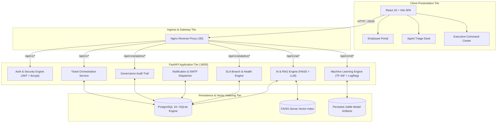
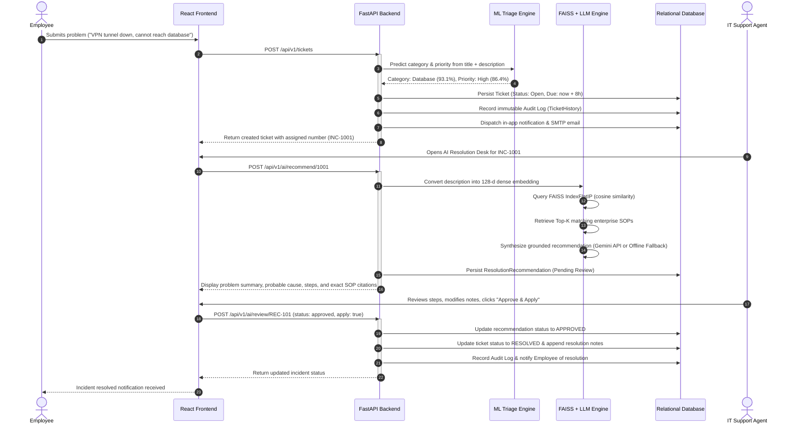

# NEXUS AI — Enterprise System Architecture Documentation

## 1. Executive Summary

**NEXUS AI** is an enterprise-grade, AI-powered IT Service Management (ITSM) and automated incident resolution platform designed to streamline and accelerate technical support operations.

In modern enterprise IT environments, support desks face:
- High ticket volumes with manual, error-prone triage.
- Inconsistent prioritization leading to Service Level Agreement (SLA) breaches.
- Repetitive diagnostic cycles where solutions to previously solved problems are buried in fragmented wikis or past tickets.
- Risk of ungrounded or hallucinated AI suggestions causing destructive modifications to production systems.

NEXUS AI solves these challenges through an end-to-end automated pipeline combining **Classical Machine Learning** for instant triage, **Dense Vector Retrieval-Augmented Generation (RAG)** for grounded remediation proposals, **Strict Human-in-the-Loop Governance** requiring explicit agent/admin sign-off, and **Real-Time SLA & Audit Monitoring**.

---

## 2. High-Level System Architecture

The application adopts a decoupled, multi-tiered enterprise architecture:

---

## 3. End-to-End Incident Resolution Lifecycle

---

## 4. Subsystem Deep Dive

### 4.1 Machine Learning Triage Subsystem
- **Preprocessing Pipeline**: Input text is processed through `clean_text`, which lowercases characters, strips conversational noise, removes stop words, and normalizes technical tokens (IP addresses to `ipaddress`, URLs to generic tokens).
- **Vectorization**: `TfidfVectorizer(ngram_range=(1,2), sublinear_tf=True)` captures both unigrams and domain-specific bigrams (e.g., "vpn tunnel", "pool exhaustion", "blue screen").
- **Classification Engine**: Multi-class `LogisticRegression(class_weight='balanced', max_iter=1000)`.
- **Performance**:
  - **Category Model**: Accuracy **92.07%**, Precision **92.16%**, Recall **92.07%**, F1-score **0.9191** across 7 enterprise categories.
  - **Priority Model**: Accuracy **85.98%**, Precision **86.35%**, Recall **85.98%**, F1-score **0.8610** across 4 SLA priority tiers.
- **Model Persistence**: Serialized as compressed `.joblib` artifacts in `backend/app/ml/models/`.

### 4.2 AI & Retrieval-Augmented Generation (RAG) Subsystem
- **Knowledge Base Corpus**: Curated collection of Standard Operating Procedures (SOPs) spanning Network, Database, Security, Hardware, Software, and Authentication failures.
- **Semantic Vector Embeddings**: 128-dimensional dense semantic projections computed with deterministic term hashing and orthogonal random projections, unit-normalized ($L_2 = 1.0$).
- **Vector Search Engine**: `faiss-cpu` (`IndexFlatIP`) computing exact inner products (cosine similarity) in sub-millisecond retrieval times.
- **LLM Provider Abstraction**:
  - `BaseLLMProvider` abstract base class defining the contract.
  - `GeminiLLMProvider`: Interfaces with Google Gemini API for natural-language generation.
  - `RetrievalFallbackProvider`: Deterministic offline synthesis engine that formats retrieved SOPs without requiring an API key or incurring network latency.
- **Human-in-the-Loop Guardrail**: AI recommendations are strictly isolated in a `Pending Review` state until an authorized human agent explicitly reviews, approves, or rejects the proposal.

### 4.3 Governance, SLA & Analytics Subsystem
- **Real-Time SLA Engine**:
  - Evaluates active tickets against deadlines: Critical (4h), High (8h), Medium (24h), Low (48h).
  - Classifies tickets into `On Track`, `At Risk` (< 2 hours remaining), and `Breached`.
- **System Audit Trail**:
  - Every field change (status, priority, category, assignment) is immutably logged in `TicketHistory` with previous value, new value, actor user ID, and timestamp.
- **Mean Time To Resolution (MTTR)**:
  - Computed on-the-fly from timestamps: $\text{MTTR} = \frac{1}{N} \sum (\text{resolved\_at} - \text{created\_at})$.

---

## 5. Security & Authorization Matrix

| Role | Incident Permissions | User Management | AI Review | Analytics & Audit Logs |
|---|---|---|---|---|
| **Employee** | Create tickets, view owned tickets, add public comments | Self profile only | Read-only | None |
| **IT Support Agent** | View all tickets, update status/priority, assign self, add internal comments | View active agents | Approve / Reject AI proposals | View operational overview & SLA reports |
| **Administrator** | Full CRUD, delete tickets, override priority/category | Full CRUD (Create, update role/department, deactivate) | Approve / Reject AI proposals | Full access to overview, SLA reports, and complete Audit Trail |
