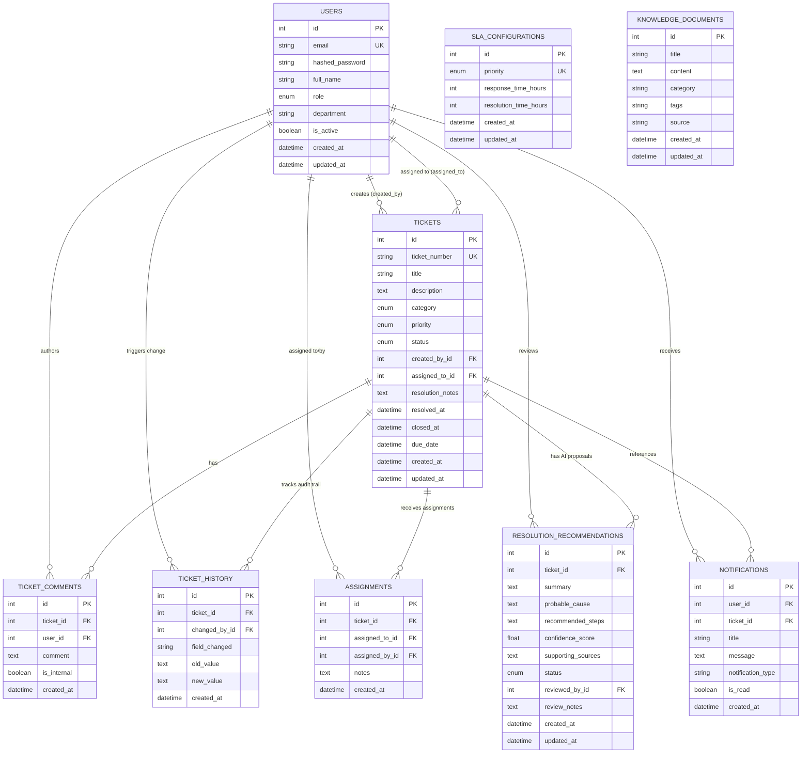

# NEXUS AI — Database Design & Schema Documentation

## 1. Overview
The NEXUS AI data layer uses **SQLAlchemy ORM** backed by PostgreSQL (and SQLite for local zero-setup development and CI). It is fully normalized (3NF), strictly typed, and tracks audit trails for all critical incident modifications.

---

## 2. Entity-Relationship (ER) Diagram

---

## 3. Enumeration Reference

### User Roles
- `Employee`: Submits and tracks own incidents.
- `IT Support Agent`: Investigates, comments internally, resolves tickets.
- `Administrator`: Full system access, assigns tickets, user role management, deletions.

### Ticket Categories
`Network`, `Hardware`, `Software`, `Database`, `Security`, `Authentication`, `Application`, `Other`

### Ticket Priorities
`Low` (48h resolution SLA), `Medium` (24h resolution SLA), `High` (8h resolution SLA), `Critical` (4h resolution SLA)

### Ticket Statuses
`Open` -> `Assigned` -> `In Progress` -> `Pending` -> `Resolved` -> `Closed`

---

## 4. Database Migrations
Migrations are managed with Alembic:
- Configuration: `backend/alembic.ini` and `backend/alembic/env.py`
- Version scripts: `backend/alembic/versions/`
- Upgrade command: `alembic upgrade head`

